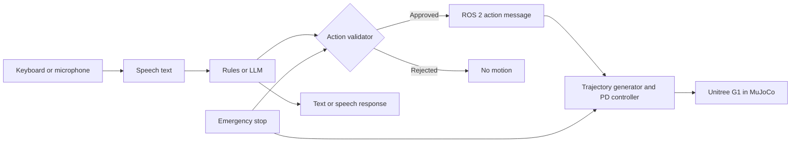

# G1-LLM-Humanoid-HRI-MuJoCo

**LLM-Driven Human–Humanoid Robot Interaction with the Unitree G1 in MuJoCo**

A safety-aware human–robot interaction (HRI) project in which typed or spoken natural-language instructions are interpreted by a rule-based parser or an optional large language model (LLM), validated against permitted robot actions, and executed by a simulated **Unitree G1 humanoid** in **MuJoCo**. Internally the project uses **ROS 2 Humble** to connect the interaction, safety, simulation, and monitoring nodes.

> **Repository setup:** The documentation is available here; the complete Python/ROS 2 source folder must be pushed from the original project directory before the run commands below will work.

## What the project demonstrates

- Natural-language robot interaction through typed input, with optional microphone input.
- Rule-based commands without internet access or API keys; optional local Ollama or cloud LLM backend.
- A dedicated safety validator that rejects unknown actions, excess commands, and raw joint controls.
- Simulated G1 upper-body gestures such as waving, pointing, raising arms, bowing and returning to neutral.
- ROS 2 message passing, emergency stopping, joint-space PD control, and activity/latency monitoring.
- A **fixed-base simulation** for education. **No balancing, walking or physical robot control.**

## Architecture



## Requirements

- **Ubuntu 22.04 LTS** and **Python 3.10**
- **ROS 2 Humble** (required for multi-node demos)
- **MuJoCo** and Python dependencies installed by the project
- **Microphone** only for the optional voice demo
- **Ollama** or **OpenAI API** only for optional LLM modes

Start with text control before attempting audio or LLM integration.

## Installation

After the full code is uploaded:

```bash
git clone https://github.com/sh1755/G1-LLM-Humanoid-HRI-MuJoCo.git
cd G1-LLM-Humanoid-HRI-MuJoCo

# Ubuntu 22.04; ROS 2 Humble is already installed
bash scripts/install.sh

# Alternatively, to also install ROS 2 Humble on a supported Ubuntu 22.04 PC:
# bash scripts/install.sh --with-ros

bash scripts/download_models.sh
bash scripts/build_ros2.sh
```

Verify the bundled G1 simulation:

```bash
python3 examples/offline_pipeline_demo.py --interactive
```

## Run the robot

**Text-based demo (recommended):**

```bash
./scripts/run_text_demo.sh
```

Try these instructions at the `you>` prompt:

```text
Hello robot!
Wave your right hand
Raise both arms
Point forward
Return to neutral
/stop
/resume
/quit
```

**Voice-controlled demo (optional):**

```bash
sudo apt update
sudo apt install -y libportaudio2 portaudio19-dev libasound2-dev alsa-utils espeak-ng
python3 -c "import sounddevice as sd; print(sd.query_devices())"
./scripts/run_voice_demo.sh
```

If no microphone is detected, use the text demo. A microphone is **not** required to test the robot.

**Optional local LLM** (install Ollama and download `llama3.2` first):

```bash
ollama pull llama3.2
./scripts/run_text_demo.sh llm_backend:=ollama
```

**Optional cloud LLM:** add your `OPENAI_API_KEY` to your **local, untracked** `.env` file, then:

```bash
./scripts/run_text_demo.sh llm_backend:=openai
```

Never commit API keys or credentials.

## Inspect ROS 2 nodes and topics

Start the simulation in one terminal and use another terminal for inspection:

```bash
source /opt/ros/humble/setup.bash
source ros2_ws/install/setup.bash
export ROS_DOMAIN_ID=8
export ROS_LOCALHOST_ONLY=1
export RMW_IMPLEMENTATION=rmw_cyclonedds_cpp

ros2 node list
ros2 topic list
ros2 topic echo /hri/robot_action
ros2 topic echo /hri/robot_status
ros2 topic hz /joint_states
```

## Which code should students change?

| File | Role | Suggested experiment |
| --- | --- | --- |
| `rule_based_parser.py` | Maps text to a supported action | Add new command phrases |
| `llm_client.py` | Optional model prompting and structured output | Modify the assistant's conversational style |
| `motion_primitives.py` | Joint positions, keyframes, and trajectories | Create a new upper-body gesture |
| `config/robot_actions.yaml` | Action allowlist and safety configuration | Register your new approved action |
| `action_validator.py` | Enforces safety constraints | Inspect and test; never bypass |
| `g1_sim.py` | MuJoCo dynamics, PD motor control | Advanced control experiments |
| `*_node.py` | ROS 2 publishers and subscribers | Add metrics or monitoring |

Search for file paths using `find . -name 'motion_primitives.py'`; ROS 2 files may be under `ros2_ws/src/`. For a new motion, add keyframes in `motion_primitives.py`, register the name in `robot_actions.yaml`, preserve joint/torque limits, and run the test suite.

## Troubleshooting

| Problem | Remedy |
| --- | --- |
| `PortAudio library not found` | `sudo apt install -y libportaudio2 portaudio19-dev` |
| No input microphone | Check Ubuntu Sound settings and `arecord -l`; use text control meanwhile |
| `unitree_g1_social_hri` package missing | Re-run `bash scripts/build_ros2.sh`, then source `ros2_ws/install/setup.bash` |
| No ROS nodes/topics | Set matching `ROS_DOMAIN_ID=8`, `ROS_LOCALHOST_ONLY=1`, and CycloneDDS settings |
| No G1 model | Re-run `bash scripts/download_models.sh` |
| MuJoCo GUI does not appear | Check your desktop display/GLFW support; use headless mode when supported |
| Ollama fails | Check whether `ollama serve` is running and the desired model is downloaded |
| OpenAI fails | Check local API key, connectivity, and billing; rule mode can work without it |
| Emergency stop active | Enter `/resume` in the text demo or reset the e-stop topic after confirming safety |

Further details are in the student installation and customisation PDF supplied alongside the original project.

## Test

```bash
./scripts/run_tests.sh
```

**Safety:** These are classroom simulation examples, not certified physical-robot controllers. Preserve third-party Unitree model licensing and attribution when adding source/assets.

## References

- [ROS 2 Humble](https://docs.ros.org/en/humble/)
- [MuJoCo](https://mujoco.readthedocs.io/)
- [Unitree MuJoCo](https://github.com/unitreerobotics/unitree_mujoco)
- [Ollama](https://ollama.com/)
